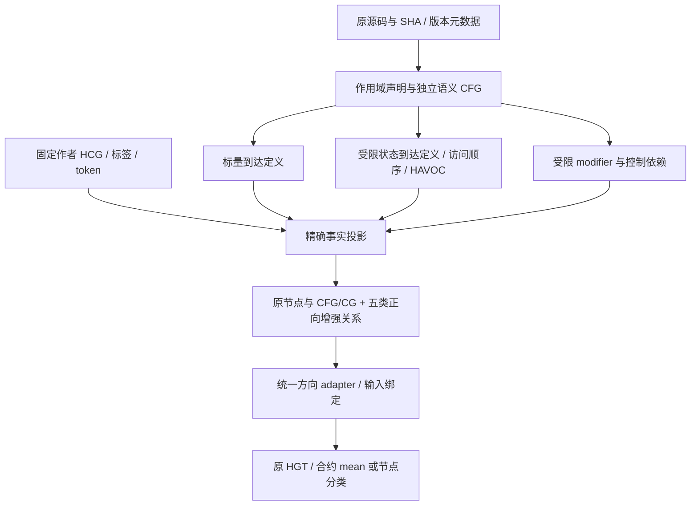

# DDG 工程统一入口 v1

2026-10-21，实施与记录：Codex。当前实现位于开发工作树 `/home/zhao/SmartContract/ge-sc-llm-ddg-v11`。

本入口将已经完成的标量、状态、顺序及控制分析串成可复核流程。它从**原作者 HCG + 已核验的对应源码**开始，保留节点、标签、token 和 CFG/CG 边，只添加经过投影的关系。这里的“完整”是当前受限工程方案完整接入，不代表完整 Solidity 数据流分析。没有引入变量节点、跨函数摘要或反向 DDG。

## 能力配置

| profile | 输出 | 关系 |
| --- | --- | --- |
| `baseline` | 原固定 HCG 的精确副本 | 无新增关系 |
| `scalar` | 原 HCG + 标量定义—使用 | `DATA_DEF_USE` |
| `full` | 上述结果 + 状态依赖及顺序 | 再加 `STATE_DEF_USE`、`STATE_ACCESS_ORDER`、`EXTERNAL_CALL_BEFORE_STATE_WRITE` |
| `full_guard` | 上述结果 + 受限控制依赖 | 再加 `CONTROL_DEPENDENCE` |

四个配置是工程开关，不是要求新增四套训练。`full` 对应已有整体 DDG 的能力集合，`full_guard` 对应已有 GUARD 能力集合；它们不是覆盖历史 E0/E1/E2/E3 的新命名。顺序关系和控制依赖分别表达访问顺序、控制约束，不能冒称定义—使用依赖。



语义 CFG 只是分析中间表示。模型中的 CFG/CG 不会被替换；不支持的函数保留为样本，相关分析器不提交该函数的部分不确定事实。状态未知来源保留 UNKNOWN/HAVOC 语义，不凭变量名字猜跨函数定义。投影使用原节点身份和精确源码对应，不按“最近一行”猜节点。标签/token不参与决定新增关系；结构节点的 AST 文本用于定位，不是漏洞标签。

## 已实现与边界

- 标量声明/作用域、DEF/USE、正向 CFG、KILL、分支 union、循环 fixpoint。
- 同合约可绑定状态及简单 mapping 位置；保守别名、写覆盖与调用 HAVOC；当前仍为函数内分析。
- 已有受限继承与单一可解释 modifier 恢复，状态访问顺序、外部调用到后续写入，以及后支配控制依赖。
- 精确原 HCG 投影、同端点不同 relation、五关系正向接入和模型输入绑定。
- 新 receiver 保护拒绝接收者表达式中的嵌套调用/副作用；未知含义采用函数级回退。普通接收者及支持的纯地址转换仍走原规则。
- 统一 `max_iterations`，默认100000，对三阶段一致生效；报告未启用阶段为None。

仍不支持完整跨函数/跨交易摘要、任意 storage 别名、任意继承/modifier组合、完整异常或任意 Solidity 表达式语义。原图不存在可精确对应的语句节点时记录投影缺失，不新增节点凑边。七类漏洞不被写死在分析算法中，但本次真实数据验收仅涉及重入和访问控制，不能声称其余五类已通过验证。

## 实际可运行命令

在 VS Code 的 WSL 终端执行；不是原编辑树目录：

```bash
conda activate mando
cd /home/zhao/SmartContract/ge-sc-llm-ddg-v11
export TREE_SITTER_LIB_DIR=/home/zhao/SmartContract/ge-sc-llm/build/linux-x86_64
export PYTHONDONTWRITEBYTECODE=1
export OMP_NUM_THREADS=2 MKL_NUM_THREADS=2
```

本轮已生成四个 `full_guard` 图，路径为：

```text
scripts/DFG/experiments/artifacts/integration_release_v1/rebuilt/
  reentrancy_author_contract/hcg.gpickle
  access_control_author_contract/hcg.gpickle
  reentrancy_author_node/hcg.gpickle
  access_control_author_node/hcg.gpickle
```

每个目录还有 `audit.json`、`inputs.json`、`manifest.json`、`comparison.json`。如果需要独立复核生成，请使用全新目录；工具拒绝覆盖已有目录：

```bash
CUDA_VISIBLE_DEVICES= python -u -B -m scripts.DFG.integration.rebuild \
  --output scripts/DFG/experiments/artifacts/integration_release_repeat_v1/rebuilt
```

该命令从已封存 guard build manifest 获取四任务的原 HCG、精确源码清单和历史参照图，并重新构造全部阶段。不会读预测来选边，不运行训练。默认参考清单仍位于 `paper_kfold/guard_extension_v1/build/manifest.json`，同时核验旁边的 seal。

单图入口：`python -B -m scripts.DFG.integration.cli --help`。必须提供 `--graph` 原始未增强HCG、`--output` 新目录；增强配置另需 `--source-manifest`。可用 `--profile baseline|scalar|full|full_guard` 和 `--max-iterations`。源码清单按图中的精确 `source_file` 键提供：

```json
{"sources": {"example.sol": {"path": "/absolute/source/example.sol", "sha256": "实际文件SHA256", "metadata": null}}}
```

清单允许沿用已核验的版本元数据；不伪造pragma范围的确定编译版本。缺源码会在报告中列出，并保留该文件原 HCG；有记录但SHA不符则报错。

从清单取真实路径的单图示例（避免未定义的BASE变量）：

```bash
CUDA_VISIBLE_DEVICES= python -B - <<'PY'
from scripts.DFG.integration.io import read_json, checked
from scripts.DFG.integration.rebuild import DEFAULT_MANIFEST
from scripts.DFG.integration.cli import main
checked(DEFAULT_MANIFEST, read_json(DEFAULT_MANIFEST.with_name('manifest.seal.json'))['sha256'])
ref = next(t for t in read_json(DEFAULT_MANIFEST)['tasks']
           if t['task_id'] == 'reentrancy_author_contract')
task = read_json(checked(ref['source_task_manifest'], ref['source_task_sha256']))
main(['--graph', str(checked(task['graphs']['HCG']['path'], task['graphs']['HCG']['sha256'])),
      '--source-manifest', str(checked(ref['source_metadata_manifest'], ref['source_metadata_sha256'])),
      '--profile', 'full',
      '--output', 'scripts/DFG/experiments/artifacts/integration_full_example_v1'])
PY
```

## 接入模型

```python
from scripts.DFG.integration.model import make_model
model = make_model('node', graph_path, profile='full_guard', device='cpu')
# 合约级用 make_model('contract', ...)，保持原 mean 读出。
```

使用既有五关系方向adapter；HGT核心、512维inside_token特征及训练规则未改。原 `scripts.DFG.cli` 仍是历史scalar入口；原通用反射器不能作为五关系方案的替代入口。不要把新图直接交给未经验证的旧加载路径，它可能反射新增关系。这里提供构图与模型装配，不新增一个训练器；历史formal控制器仍绑定各自旧图和seal。

## 验证与归档

本轮最终联合回归613通过，0失败/跳过，31条既有DGL/Torch/NetworkX弃用warning。完整命令记录于 `../experiments/artifacts/integration_release_v1/regression_003.log`。

快速复核新增模块：

```bash
CUDA_VISIBLE_DEVICES= python -B -m pytest -q --import-mode=importlib -p no:cacheprovider \
  scripts/DFG/integration/tests scripts/DFG/experiments/integration_diagnostics/tests
```

历史归档核验按旧计划的记录名单检查，不因新增旁路文件而误报旧运行版本变化；原记录文件改动仍拒绝。当前支持overall_cv、guard_extension、readout_attention三种已知计划，不是绕过任意seal的工具：

```bash
CUDA_VISIBLE_DEVICES= python -B -m scripts.DFG.integration.archive \
  --batch scripts/DFG/experiments/artifacts/paper_kfold/overall_cv_v1 \
  --output scripts/DFG/experiments/artifacts/overall_archive_repeat_v1.json
```

本轮已核验overall_cv的60个结果及其收据、689个冻结文件身份；checkpoint按SHA核验，本轮没有重载全部训练后checkpoint。

有限源码Oracle和实际模型聚合诊断：

```bash
CUDA_VISIBLE_DEVICES= python -B -m scripts.DFG.integration.oracle select \
  --output scripts/DFG/experiments/artifacts/integration_oracle_repeat_v1
CUDA_VISIBLE_DEVICES= python -B -m scripts.DFG.integration.oracle validate \
  --selection scripts/DFG/experiments/artifacts/integration_oracle_repeat_v1/selection.json
CUDA_VISIBLE_DEVICES= python -u -B -m scripts.DFG.experiments.integration_diagnostics.message_probe \
  --output scripts/DFG/experiments/artifacts/integration_probe_repeat_v1
```

12函数Oracle结果：4应有关系、4应无特定关系、4应回退，均符合冻结预设。由Codex源码审阅，未取得独立人工签署，未执行solc；解析成功不是编译成功。

聚合诊断使用四任务保存的未训练共同初值，未运行optimizer。原消息的canonical mean分母会随新关系数量改变，即使节点本身没有新增入边。该证据说明接入会改变消息，不能认定为训练后低收益的唯一原因，也不能当成新F1结果。

## 当前交付结论

四任务新图与旧图的模型输入完全等价；两个节点任务只有 `ddg_fact_indices` 重编号，不影响HGT读取，但完整图fingerprint确实不同，不能据此改写旧checkpoint绑定。后续使用新图须绑定自己的输入manifest，旧结果继续归旧运行版本。

当前方案已经完成可运行的构图—投影—融合—HGT接入—验证闭环。既有完整K折没有稳定提升，本轮没有新增fit或改变这个结论。保持mean与冻结基线；如果继续研究，聚合方式应作为独立、受控的方法候选，而不是未经验证地继续堆关系。

详细报告：[本轮实现与验收](../experiments/artifacts/integration_release_v1/IMPLEMENTATION_REPORT.md)。
