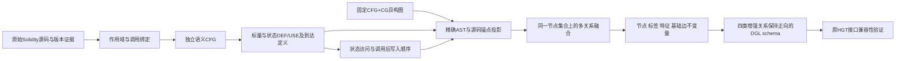

# DDG整体构图入口：Stage J

更新：2026-10-19；实现与核验：Codex。工作树：`ge-sc-llm-ddg-v11`。

本目录将已有标量DDG、状态分析、顺序关系和精确投影接成可切换的构图入口，并新增受限同源继承、前置modifier恢复。它复用原模型节点，只增加有类型的关系；不是三个编码器分别训练再拼接向量。原Stage F和Stage G/H结果保留。

## 构图流程



语义CFG只用于分析，不替换模型CFG/CG。将依赖事实先视为独立的DFG边集合、再投影并与HCG融合，与“并行构图后融合”在共享节点时是一致的实现路径。这里没有变量节点，也没有新增标签或token。

## 四种关系

| 关系 | 含义 |
|---|---|
| DATA_DEF_USE | 局部标量的到达定义→使用，复用现有实现 |
| STATE_DEF_USE | 已确认同一状态位置的到达写入→读取 |
| STATE_ACCESS_ORDER | 同一状态位置上的访问顺序；不能当作Def–Use |
| EXTERNAL_CALL_BEFORE_STATE_WRITE | CFG路径上的外部调用→后续状态写入顺序 |

均为正向边；不新增反向关系、控制依赖或跨函数摘要。CFG路径见证不等于求解全部路径条件后证明可执行。

## 文件职责

| 文件 | 职责 |
|---|---|
| configuration.py | 关闭DDG、状态关系子集、恢复范围配置 |
| binding.py | 同一源码内唯一基类绑定、右侧优先C3校验、成员声明身份 |
| modifiers.py | 唯一绑定、无参数、单一末尾占位符的前置modifier校验 |
| analyzer.py | 只重试Stage F原回退函数；原成功结果复用；失败不留下部分状态事实 |
| pipeline.py | 分析、投影、物化、证据来源、不变量统一入口 |
| cli.py | 输入SHA检查、独立输出、canonical schema及方向检查 |
| tests/ | 54项新增语义/融合/接口回归测试 |

详细边界见 [DESIGN_AND_ACCEPTANCE.md](DESIGN_AND_ACCEPTANCE.md)。

## Python接口

```python
from scripts.DFG.state.stage_j.configuration import DDGConfig
from scripts.DFG.state.stage_j.pipeline import prepare_graph

enhanced, audit = prepare_graph(
    hcg,
    sources={"example.sol": original_source_text},
    metadata={"example.sol": verified_version_metadata},
    config=DDGConfig(add_scalar=True, state_mode="orders", recovery="modifiers"),
)
```

- 原始HCG输入：`add_scalar=True`先复用现有标量模块；它的标量支持范围没有扩大。
- 已有冻结E2输入：`add_scalar=False`，保留已有DATA_DEF_USE。
- `state_mode="def_use"`只物化STATE_DEF_USE；`"orders"`同时物化两种状态顺序关系；`"off"`不添加状态边。
- `recovery="frozen"`复现Stage F；`"inheritance"`开启受限继承；`"modifiers"`再开启受限modifier。
- `use_ddg=False`精确复制传入图，不解析源码。**不会从已经增强的输入图中反向删除DDG**；恢复原baseline时须传入原baseline图。
- 启用状态分析时拒绝已经带状态关系的输入，防止把两版事实混在同一图里。
- 原始代码中不支持的状态/调用按原策略回退，保留原样本。未映射写入仍在分析中执行KILL，不按最近行号补节点。

## 终端入口

使用现有mando环境，从开发工作树运行：

```bash
conda activate mando
cd /home/zhao/SmartContract/ge-sc-llm-ddg-v11
export TREE_SITTER_LIB_DIR=/home/zhao/SmartContract/ge-sc-llm/build/linux-x86_64
```

通用CLI参数如下。输入必须是可信本地pickle；填入真实图路径和SHA，输出必须是新目录：

```bash
python -B -m scripts.DFG.state.stage_j.cli \
  --graph /absolute/path/to/hcg.gpickle \
  --graph-sha256 ACTUAL_SHA256 \
  --sources /absolute/path/to/sources.json \
  --output /absolute/path/to/new_output \
  --add-scalar --state-mode orders --recovery modifiers
```

`sources.json`以图中source_file为键：

```json
{
  "sources": {
    "example.sol": {
      "path": "/absolute/path/to/example.sol",
      "sha256": "ACTUAL_SOURCE_SHA256",
      "metadata": null
    }
  }
}
```

pragma证据充分时metadata可为空；有已核验版本记录则使用现有版本metadata，不从宽pragma范围伪造单一版本。命令行即使`--disable-ddg`仍先验证输入图和source manifest；Python关闭接口不需要源码。

输出：`enhanced.gpickle`、`audit.json`、`manifest.json`。含原图/源文件身份、配置、事实侧表、回退原因、图指纹、schema、关系数量；输出存在时拒绝覆盖。

四任务真实构图入口见 [stage_j_coverage README](../../experiments/stage_j_coverage/README.md)。本批结果见 `scripts/DFG/experiments/artifacts/paper_kfold/stage_j_v1/STAGE_J_RESULT_REPORT.md`。

## 模型边界

本入口调用原Stage F方向适配器：原CFG/CG按原策略处理，四种增强关系保持正向。实际HGTLayer的合成前向、反向梯度及checkpoint重载测试通过，optimizer_steps=0。

**不直接将新状态图传入旧train_node.sh/train_contractlevel.sh。** 原通用加载器不能保证四类状态关系方向。现有e23_pilot已有正确适配，但其旧计划冻结了图SHA，不能换图冒充原批次。本轮只生成候选图和验收记录；新正式训练需独立绑定图、schema、共同初始化及计划。没有改HGT或原训练脚本，也没有执行新训练。
