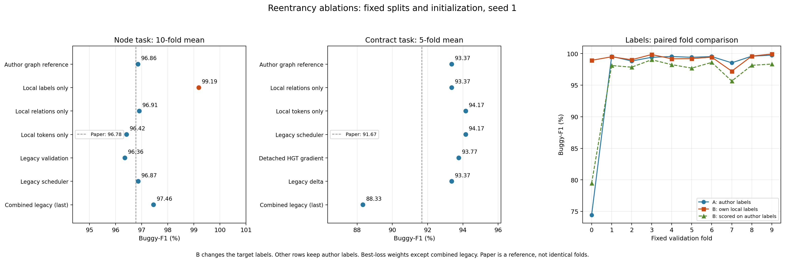

# 重入固定折对照实验：结果与分析

- 实施 AI：**Codex**。
- 新建日期：2026-10-08。
- 正式训练开始（UTC）：2026-10-08T13:51:44.814680+00:00。
- 正式训练结束（UTC）：2026-10-09T02:04:42.415354+00:00。
- 状态：**14 组全部完成，105 折；seed=1**。节点 7 组 × 10 折，合约 7 组 × 5 折。
- 本次只在 `scripts/reentrancy_ablation/` 新增代码、图、权重和报告，原训练器、构图器、标注器、训练输入及原交接文档均未编辑。

## 结论

本轮最直接的证据是：保持图连接、边类型、token、折清单和初始化不变，仅替换本地 source_range 标签，节点 Buggy-F1 从 **96.8613** 变为 **99.1898**。同一批 B 组预测改用作者标签评分，结果为 **96.1147**。因此，这里的 99 分主要体现了目标标签及其一致性变化，不能直接称为超过论文的检测能力。

合约任务的差异有另一条证据链：同一个 A 组训练过程，best 为 **93.3675 / 93.6017**，last 为 **91.5524 / 91.4848**。选轮方式本身就能造成约 1.82 个 Buggy-F1 百分点的差别。此外，文本编码、调度行为也有影响。边类型替换在本次固定折实验中影响很小。

这些结论针对本轮重入对照，尚不能代替权限访问控制的同类实验，也不代表已恢复作者未公开的全部运行条件。

## 实验固定了什么

| 项目 | 本轮设置 |
|---|---|
| 合约输入 | 作者 CFG+CG 融合图，142 文件，71 漏洞文件，18,312 节点 / 19,267 边 |
| 节点输入 | 同一融合图中 71 个漏洞文件的完整诱导子图，12,036 节点 / 11,710 边 |
| 折清单 | 从本机历史作者 HCG 运行的 selection.json 冻结；合约 5 折、节点 10 折 |
| 初始化 | 同折 A/B/D/训练行为组完整初始权重一致；C 共享参数及共有关系参数一致 |
| 模型 | 原有 HGT 模型，输入512维、hidden128、2层、8头、dropout=.2、LayerNorm=True |
| 特征 | Salesforce/codet5p-770m tokenizer 的512维 Token ID；未运行完整LLM encoder，也未微调LLM |
| 训练 | 每组上限50轮；patience=7；当前delta=.001；每折重新创建模型和优化器 |
| 保存 | 每折 best.pt / last.pt；best按监控loss绝对最低值选，停止计数单独应用delta |
| 评分 | 所有最终分数重新执行eval前向；逐样本预测、逐轮日志与权重均保存 |

冻结的是**本机历史运行的划分**，不是作者论文未公开的原始折清单。节点没有跨训练/验证文件的图边。每个文件在交叉验证中恰好被留出一次。

A 的图结构和标签来自作者下载文件，token 是此前在本地生成的。作者原始图没有 token 属性，不能把 A 称为作者完整的原始训练包。

## 完整结果

下表均为各折 F1 的算术平均，单位为百分数。来源子集的 pooled F1 在后文另列，不能与这些均值混用。组合原版行为组的主结果采用 last，其余组采用 best；同时列出两者以避免只挑更高值。

### 节点任务：10折

| 实验 | best Buggy-F1 | best Macro-F1 | last Buggy-F1 | last Macro-F1 |
|---|---:|---:|---:|---:|
| A：作者图参照 | 96.8613 | 97.0197 | 97.4387 | 97.5915 |
| B：仅换 source_range 标签 | 99.1898 | 99.1295 | 99.2523 | 99.1789 |
| C：仅换本地边类型 | 96.9104 | 97.0756 | 97.3868 | 97.5679 |
| D：仅换本地 token | 96.4233 | 96.5462 | 97.2549 | 97.4268 |
| 原版节点验证方式 | 96.3581 | 96.3502 | 97.4828 | 97.6683 |
| 原版调度行为 | 96.8697 | 97.0297 | 97.4258 | 97.5734 |
| 原版关键行为组合 | 96.3579 | 96.3502 | 97.4550 | 97.6289 |

B 组使用本地标签时的 best 为 **99.1898 / 99.1295**；保持该组预测不变、对共同作者标签评分，为 **96.1147 / 96.0546**。

### 合约任务：5折

| 实验 | best Buggy-F1 | best Macro-F1 | last Buggy-F1 | last Macro-F1 |
|---|---:|---:|---:|---:|
| A：作者图参照 | 93.3675 | 93.6017 | 91.5524 | 91.4848 |
| C：仅换本地边类型 | 93.3675 | 93.6017 | 91.6969 | 91.5051 |
| D：仅换本地 token | 94.1652 | 94.3224 | 93.4815 | 93.6127 |
| 切断合约 HGT 梯度 | 93.7682 | 93.6245 | 93.7682 | 93.6245 |
| 原版调度行为 | 94.1652 | 94.3224 | 94.1652 | 94.3224 |
| delta 改为 0.005 | 93.3675 | 93.6017 | 91.5524 | 91.4848 |
| 原版关键行为组合 | 88.3301 | 87.9659 | 88.3301 | 87.9659 |

论文 Dataset A / CodeT5p-770m 对应的是 Table 3 合约 **91.67 / 91.49**，Table 5 细粒度 Buggy-F1 **96.78**；Table 5 没有 Macro-F1。当前节点指标沿用公开仓库的节点计分单位，没有展开并去重为唯一物理源码行。本文没有评测两阶段级联后的整体分数。[论文原文](https://daoyuan14.github.io/papers/TOSEM25_MANDO-LLM.pdf)



## 标签：408处翻转与一个关键合约

本轮 B 采用的文件是：

`scripts/labeling_v2/artifacts/labels_v1/source_range/contractlevel.gpickle`

这是 source_range 版本。历史 `hcg_narrow.gpickle` 的6978个正例属于另一版本；本轮没有混用它的统计。

| 统计 | 作者 A | 本地 source_range B |
|---|---:|---:|
| 漏洞节点总数 | 6570 | 6976 |
| buggy_18.sol 总节点数 | 424 | 424 |
| buggy_18.sol 漏洞节点数 | 35 | 252 |

逐节点比对得到408处标签翻转：407处从0变1，1处从1变0，净增加406个正例。217处集中于 `buggy_18.sol`。全局分歧涉及137个 contract_declaration、72个 expression_statement、67个 function_definition、54个 new_variable、52个 if、26个 end_if。

固定第0折包含该合约：

- A 组该折 Buggy-F1：74.4417。
- B 组对本地标签评分：98.9384。
- B 组同一预测对作者标签评分：79.4567。
- 第0折的自身标签分数变化：+24.4967个百分点。
- 其他9折自身标签分数变化的平均值：-0.1347个百分点。

因此，总体均值上涨不能解释成所有合约的检测能力普遍增强。标签变化减轻了这个关键文件与其他训练样本之间的监督不一致，同时也改变了验证目标。

此前的源码审计已经记录两类不同原因：

1. **节点范围映射规则不同**：本地 source_range 考察映射回源码后的节点覆盖行集合；作者图的现有标签可由其存储的行号端点与恢复出的标注重放。函数/合约声明等跨多行节点会因此改变标签。
2. **标注集合本身不同**：例如 buggy_18 中单行语句 `balances_re_ent15[msg.sender] = 0;`，本地源码第299行、预处理第218行，作者图为0、本地为1；单行节点的差别不能归结为范围/端点之争。旧审计还发现该文件恢复出的作者标注存在超出对应源码范围的行号，说明标注来源或坐标有不一致迹象。

这些是已有图和源码的审计证据，不能据此唯一恢复作者当年缺失的标注生成过程。[此前标注审计](../../outputs/graph_alignment_review_20261008/label_alignment.json)

本地全范围标签也不能只因 F1 更高就被判错。严格复现应单列作者图标签；使用自行核验的源码标签则应作为另一套明示的实验条件。不要为了接近论文分数反向改标签。

## 特征：同一tokenizer，实际输入文本不同

全量重新编码核验：

- A：18,312/18,312个向量匹配“作者图保存的原始 DOT 字符串”，包括外层引号、转义换行。
- D：18,312/18,312个向量匹配本地节点的实际 code 文本。
- A与D的18,312个向量全部不同。
- 简单解码作者字符串后，有18,298个节点能够复现D；另14处文本差异被保留在审计记录中，没有忽略。

两组都使用 CodeT5p-770m tokenizer，不是换了另一种 LLM，也不是完整encoder与tokenizer之间的对比。

仅替换 token 时，节点 Buggy-F1 变化为 −0.4380个百分点，合约变化为 +0.7977个百分点。这说明文本规范化需要固定并记录，但它在本轮中没有单独造成节点99分。[特征核验](artifacts/v1/feature_text_audit.json)

## 图结构：本轮边类型差异不是主要解释

C只转移本地的边类型，保持每条边的端点和重数、节点、标签和token不变。作者8种原始边类型与本地7种的差别，会进一步改变HGT的canonical关系schema：

- 节点A有146个canonical关系、4,371,010个可训练参数。
- 节点C有132个canonical关系、4,256,098个可训练参数。
- 共享非关系参数及相同canonical关系参数复用A的初始值；新增关系按固定种子初始化。

所以不能声称C的完整参数集合与A相同。这是更换关系schema本身带来的变化。

结果：节点 best Buggy-F1 变化 +0.0491个百分点，合约 best 分数相同。本轮没有证据支持“8类边变7类边导致普遍虚高”的解释。这也不证明调用图解析完全正确；重载解析、空格匹配以及关系语义等问题，不在这项端点固定的对照中修复。

## 训练流程：选轮、梯度与调度应分别判断

**选轮影响已直接观察到。** 合约A的best和last分别为93.3675和91.5524；节点A分别为96.8613和97.4387。best按loss选取，并不保证它的F1一定大于last。合约last接近论文数值，只说明选轮足以造成当前量级的偏差，不能用分数相近证明作者使用了完全相同的划分、特征与权重。

**梯度正确性不能用高F1代替。** 单独切断合约HGT梯度后，Buggy-F1仍为93.7682。实际权重核验表明，该组每折360个主干张量全部不变，只有分类头2个张量更新；正常组主干发生更新。这个结果说明数据上的高分并不能证明端到端HGT训练成立，不支持为追求论文分数而恢复梯度中断。

**调度不是只有一个学习率常数。** 当前节点LR为.0002→.005→.0002，合约为.0005→.01→.0005。旧式节点OneCycle最低约2e-8；旧式合约在构造OneCycle后不step，实际LR恒定.0004。默认OneCycle还调整Adam beta1，合约旧式不step时beta1恒定.95，所以T_lr_legacy应称为调度行为对照。[实际调度曲线](artifacts/v1/scheduler_trace.json)

节点调度单独变化仅+0.0084个百分点；合约单独变化+0.7977个百分点。delta=.001与.005在本轮5折中连停止轮次都相同，不是这轮差距的解释。

**组合结果不能由单项差值相加。** 组合原版关键行为后，节点主结果last为97.4550，合约为88.3301。该组合测量了梯度、验证、调度、delta与末轮选取的相互影响；它仍使用共同折、共同初始化和50轮上限，不能冒充作者原始实验环境。结果表明“全部回滚就会自动复现论文”也不成立。

## 高分与跨合约重复：已知风险与证据边界

本图中40个buggy_*文件均能在本地SolidiFI重入源码目录找到，其余31个文件均能在SmartBugs重入目录找到。A的6570个正例中，6537个来自SolidiFI，占99.50%。

下面使用**汇集全部留出预测后的pooled F1**，与前面fold mean不是同一统计口径：

| 作者A的来源子集 | 节点数 | 正例数 | pooled Buggy-F1 |
|---|---:|---:|---:|
| SolidiFI | 10891 | 6537 | 97.4989 |
| SmartBugs | 1145 | 33 | 44.9438 |

高总体分数没有意味着真实漏洞子集也达到相同水平。固定折只保证各组对照一致，没有消除模板重复。

进一步按“节点类型+解码后的完全相同代码”检查训练/验证重合：作者标签的验证正例中，99.8021%能在训练折找到相同代码和相同正例标签。本地标签版本相应比例为97.7924%。这说明存在大量可利用的重复信息，但不是模型只靠记忆的证明。

为明确证据边界，同时做了不使用验证标签选预测的查表诊断：只在训练折建立代码键的多数标签，未命中用训练多数类，得到A的fold mean Buggy-F1=82.3568、B=85.1744。它没有复现HGT全部高分。另一个固定命名探针“代码包含re_ent则预测漏洞”得到87.7946和89.5496，说明合成注入标识符也提供了可利用线索；这些探针没有参与模型训练或选轮。[重复审计](artifacts/v1/label_overlap_audit.json)、[命名探针](artifacts/v1/injected_name_probe.json)

## 验证与文件范围

已完成：

- 4项测试全部通过：真实折隔离与覆盖、图单因素不变量、梯度切换、共有初始化及早停行为核验。
- 节点/合约各一折两轮短跑；短跑不进入正式汇总。
- 14个正式实验、105折完成；每折保存best/last、逐轮history.jsonl和留出predictions.json。
- 全部105折核验保存权重是否按预期更新；梯度中断的两个合约组仅更新分类头。
- 从全部留出预测复算F1，核验checkpoint哈希、样本恰好留出一次、预测文件与固定折清单一致。
- 161个已有代码/文档文件哈希未变；原输入图及标签、准备后的对照图、固定折与15份原历史selection.json均通过完整性检查。

结果与证据入口：

- [完整CSV](artifacts/v1/summary.csv)
- [完整JSON及配对逐折差值](artifacts/v1/summary.json)
- [图形PNG](artifacts/v1/comparison.png)、[图形PDF](artifacts/v1/comparison.pdf)
- [输入图/标签/原代码哈希清单](artifacts/v1/prepared/manifest.json)
- [权重更新审计](artifacts/v1/weight_update_audit.json)
- [运行环境](artifacts/v1/environment.json)
- [代码职责和命令](README.md)
- [Codex修改记录](CHANGES.md)

## 仍然不能据此下的结论

1. **没有恢复作者完整实验包。** 原始折清单、确切token文本预处理和部分标注生成过程仍缺失；A包含本地重建特征。
2. **没有证明所有漏洞都会同样偏高。** 本轮只对重入执行了这些受控实验；权限访问控制需要自己的作者参照图和标注审计。
3. **没有独立外层测试集。** 各折的验证集同时用于早停/选轮及报告，沿用当前复现口径；不能当作未用于模型选择的外部测试结果。
4. **尚未测量多种子稳定性或模板隔离泛化。** 这是seed=1的配对实验，CV折并非独立统计重复；没有据此给出显著性结论。
5. **单因素结果不等于全组合结果。** 本轮没有把所有本地改动同时叠加后重新估计交互效应；不同因素的差值不可直接相加。
6. **不证明CFG/CG构建语义无误。** 本轮固定了端点，仅比较既有边类型；它不是对调用解析正确性的完整验证。
7. **没有给出唯一源码行F1或级联总体F1。** 节点分类分数、合约分类分数以及两阶段端到端分数应分别报告。

## 下一步采用什么口径

建议把两条研究口径保留下来并明确命名：

- **作者工件复现**：使用作者图及原有节点标签，固定文本编码策略、折、实际超参数和checkpoint选择规则，报告与论文的差异。
- **源码标注核验后的实验**：保留独立验证过的source_range标签，明确其正例数量和节点范围定义；先重新建立本地基线，再评估DFG等新增改动。

保留梯度连通、正确eval验证和可追溯的best/last保存，不以“是否更接近论文分数”决定代码正确性。之后可在相同折上增加随机种子，再单独做模板分组划分和独立测试，避免将复现与泛化评估混成一个分数。

如需复算已有汇总，在WSL终端执行：

```bash
conda activate mando
cd /home/zhao/SmartContract/ge-sc-llm
python scripts/reentrancy_ablation/summarize_results.py
python scripts/reentrancy_ablation/audit_weight_updates.py
python scripts/reentrancy_ablation/plot_results.py
```

复用已有完成结果可运行 `bash scripts/reentrancy_ablation/run.sh`。如果要增加一套新初始化而保持折清单不变，另用seed=2；这不是本轮已完成的实验：

```bash
bash scripts/reentrancy_ablation/run.sh --seed 2 2>&1 | tee scripts/reentrancy_ablation/artifacts/v1/suite_seed_2.log
```
